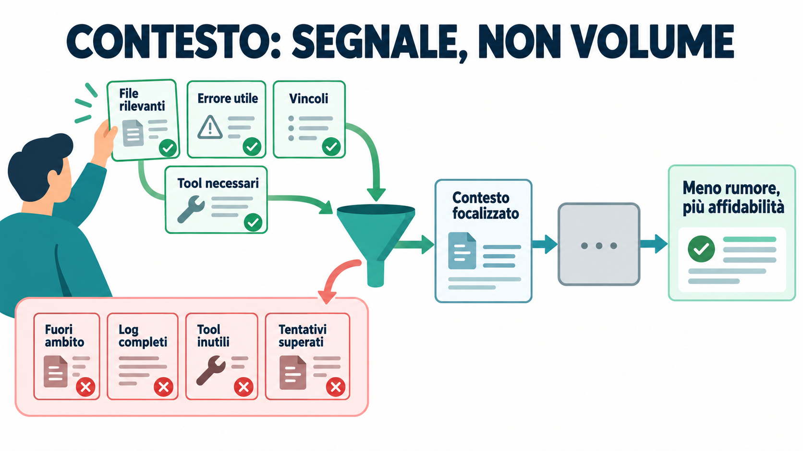
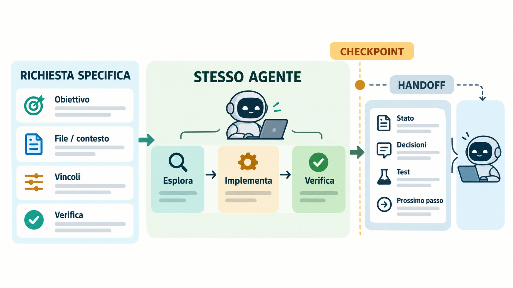
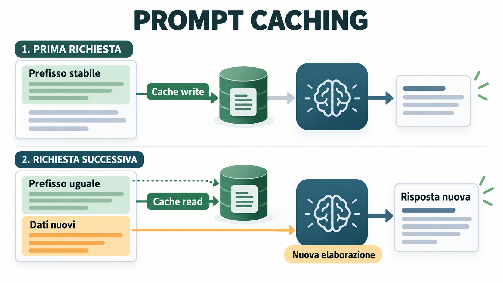
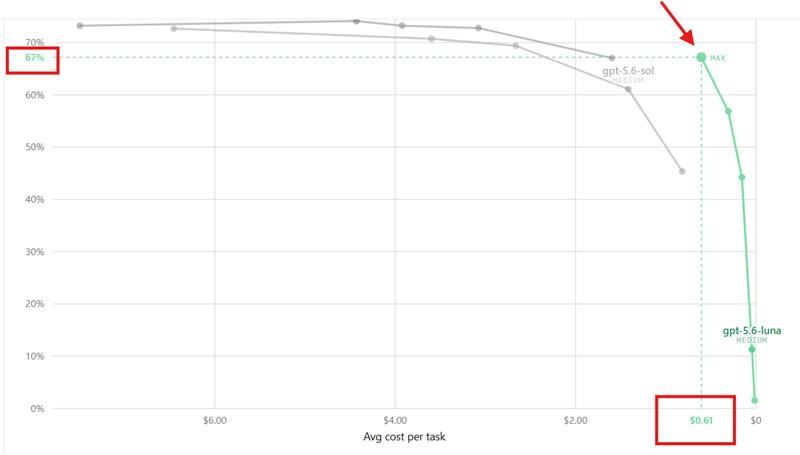
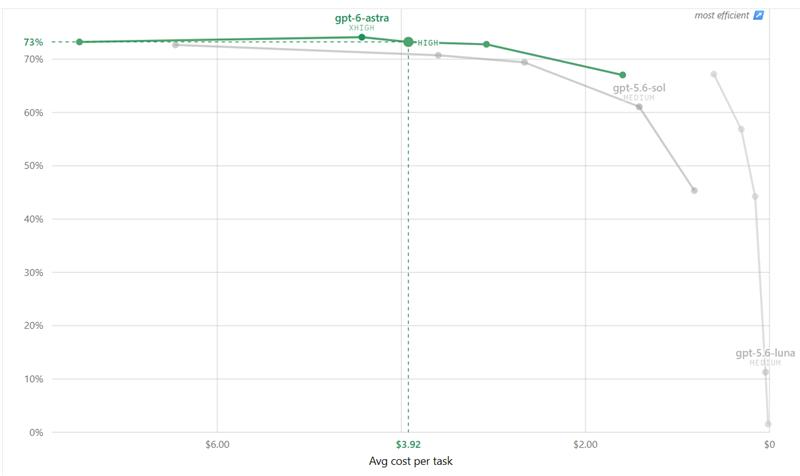
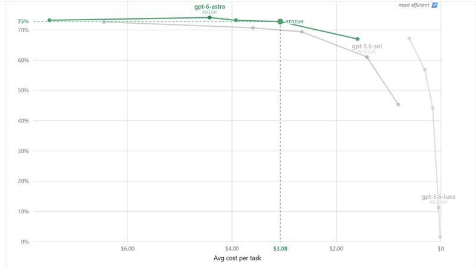

# Usare Cursor in modo efficiente

*Guida pratica a token, contesto e costi*

Cursor è un editor di codice che integra strumenti di intelligenza artificiale per aiutare nello sviluppo software. Puoi usarlo per comprendere il codice, cercare la causa di un errore, modificare i file di un progetto e verificare il risultato.

Durante queste attività, i modelli ricevono informazioni ed elaborano risposte. Il testo viene suddiviso in unità chiamate token, il cui conteggio contribuisce a determinare il consumo. Oltre alla richiesta scritta nella chat, possono contare anche i file letti, le istruzioni del progetto, la conversazione precedente e i passaggi necessari per completare il lavoro.

Capire come vengono utilizzate queste informazioni aiuta a fare scelte più consapevoli: quali file fornire, come formulare una richiesta, quale modello usare e quando proseguire nella stessa conversazione. Lo scopo di questa guida è spiegare queste scelte e mostrare come contenere il consumo mantenendo risultati corretti e verificabili.

La guida introduce prima token e contesto, poi accompagna la preparazione e lo svolgimento di un'attività in Cursor. Gli ultimi capitoli spiegano come valutarne il costo complessivo; le appendici approfondiscono la cache, i confronti fra modelli (benchmark), le procedure riutilizzabili (skill) e i dettagli sulle configurazioni esistenti.

## Indice

1. [Capire da dove arriva il consumo](#1-capire-da-dove-arriva-il-consumo)
2. [Preparare una richiesta su cui si possa lavorare](#2-preparare-una-richiesta-su-cui-si-possa-lavorare)
3. [Dare al modello il contesto necessario](#3-dare-al-modello-il-contesto-necessario)
4. [Scegliere modalità, modello ed effort](#4-scegliere-modalità-modello-ed-effort)
5. [Tenere leggere regole, skill e strumenti](#5-tenere-leggere-regole-skill-e-strumenti)
6. [Portare avanti il lavoro senza perdere il filo](#6-portare-avanti-il-lavoro-senza-perdere-il-filo)
7. [Misurare il risparmio sul lavoro completo](#7-misurare-il-risparmio-sul-lavoro-completo)
8. [Checklist da usare durante il lavoro](#8-checklist-da-usare-durante-il-lavoro)

Approfondimenti:

- [A. Come leggere cache read e cache write](#appendice-a-come-leggere-cache-read-e-cache-write)
- [B. Che cosa ricavare dai benchmark](#appendice-b-che-cosa-ricavare-dai-benchmark)
- [C. Due esempi riutilizzabili per le skill](#appendice-c-due-esempi-riutilizzabili-per-le-skill)
- [D. Formati di istruzioni e condizioni storiche](#appendice-d-formati-di-istruzioni-e-condizioni-storiche)
- [Fonti e risorse](#fonti-e-risorse)

## 1. Capire da dove arriva il consumo

### Token, contesto e finestra

Un modello linguistico divide il testo in **token**: unità che possono corrispondere a parole brevi, parti di parole, spazi o simboli. Il programma che esegue questa suddivisione si chiama *tokenizer*. Il conteggio dipende dal modello e dalla lingua; il numero di parole dà soltanto una stima.

La richiesta che scrivi al modello si chiama *prompt*. Per rispondere, il modello può ricevere anche la conversazione precedente, istruzioni del progetto, file e risultati delle operazioni già eseguite. Tutto questo materiale forma il **contesto**.

La **finestra di contesto** è il limite tecnico di ciò che il modello può considerare in una richiesta, tenendo conto del materiale ricevuto e dello spazio per la risposta. Una finestra ampia permette di includere più materiale, ma la sua capienza non indica quanto hai speso.

Le immagini e gli altri contenuti contribuiscono al conteggio secondo le regole del modello. Perciò misurare solo il testo della domanda non basta a descrivere l'intera richiesta ([OpenAI: token](https://help.openai.com/en/articles/4936856-understanding-and-counting-tokens)).

### Come lavora un agente

In Cursor, un agente usa il modello per portare avanti un'attività attraverso più operazioni. Può cercare file, leggere codice, applicare modifiche ed eseguire verifiche. Per farlo chiama degli **strumenti**, indicati anche come *tool*: funzioni per interagire con file, terminale e altri sistemi.

Dopo un'operazione, il suo risultato può entrare nel contesto della chiamata successiva. Una richiesta nella chat può quindi avviare molte chiamate al modello. Ogni passaggio può aggiungere contenuto, anche quando il contesto resta entro la finestra disponibile.

Per esempio, correggere un errore può richiedere una ricerca, la lettura di due file, una modifica e l'esecuzione di un test. Se il test fallisce, l'agente legge l'errore e riprende il lavoro. Il consumo riguarda l'intero percorso.

### Che cosa viene conteggiato

L'**input** è ciò che il modello riceve; l'**output** è ciò che genera. Alcuni modelli svolgono anche un lavoro interno di ragionamento, indicato come *reasoning*, che può incidere sul consumo senza comparire nella risposta visibile.

La **cache** permette di riutilizzare parte del calcolo già svolto su un inizio del prompt compatibile, detto *prefisso*. Il suo riuso e la sua registrazione possono avere tariffe diverse da quelle dell'input nuovo.

| Voce | Che cosa indica | Come leggerla |
|---|---|---|
| Input | Contenuto inviato al modello: istruzioni, file, cronologia e altri dati. | Guarda quanto è pertinente e quanto viene riproposto. |
| Cache read | Un prefisso già elaborato viene riutilizzato. | Ha una tariffa propria; il totale può sommare molte chiamate. |
| Cache write | Un prefisso viene registrato per un possibile riuso. | Prezzo e durata dipendono dal fornitore del modello. |
| Output | Risposta, codice, confronti fra versioni dei file (diff) e contenuto generato per i tool. | Anche ciò che l'agente genera per lavorare può contribuire al consumo. |
| Reasoning | Lavoro interno dei modelli che lo supportano. | Una risposta visibile corta può aver richiesto molto ragionamento. |

Queste voci non hanno definizioni e tariffe identiche presso tutti i fornitori dei modelli, detti provider. In particolare, non aggiungere automaticamente il costo di cache write a quello di input per gli stessi token: applica la categoria prevista dalla tabella del modello. Anche il trattamento del reasoning va verificato per evitare doppi conteggi.

```text
costo dell'attività ≈
somma di input nuovi + cache write + cache read + output/reasoning
su tutte le richieste dell'attività,
con le tariffe del modello e del piano in uso
```

La formula descrive il meccanismo, non sostituisce il conteggio di Cursor. I crediti inclusi e le condizioni di fatturazione dipendono dal piano; il consumo varia anche con il modello scelto. La selezione automatica del modello, chiamata Auto, è ripresa nel capitolo 4. Per prezzi e disponibilità usa [Models & Pricing](https://cursor.com/docs/models-and-pricing).

### Su che cosa intervenire

Il costo si valuta sul risultato completato e verificato, includendo i passaggi intermedi. Una risposta corta può aver richiesto molte operazioni; un modello economico può richiedere più tentativi.

Nei capitoli successivi vedremo come preparare la richiesta, scegliere il contesto e seguire il lavoro. [L'appendice A](#appendice-a-come-leggere-cache-read-e-cache-write) approfondisce i contatori della cache.

## 2. Preparare una richiesta su cui si possa lavorare

Prima di avviare il lavoro, descrivi il comportamento da ottenere e come riconoscerai una soluzione corretta. I riferimenti al codice aiutano l'agente a scegliere da dove cominciare.

### Un esempio che seguiremo nella guida

Immagina che il form di registrazione accetti una password composta solo da spazi. La funzione da controllare si chiama `validateLoginForm` e si trova in `src/auth/login.ts`. Useremo questo caso, ipotetico, per mostrare le diverse scelte durante il lavoro.

"Perché non funziona?" lascia all'agente tutta la ricostruzione. Una richiesta più utile è:

> Controlla perché `validateLoginForm` in `src/auth/login.ts` accetta una password composta solo da spazi nel form di registrazione. Correggi la validazione senza cambiare il comportamento delle password valide. Individua i test pertinenti, aggiungi la verifica del caso segnalato ed eseguili. Alla fine riporta modifica ed esito dei test.

La richiesta contiene il problema, il punto da cui partire, un vincolo e una verifica. Il percorso dei test va cercato se non è ancora noto.

### Separare obiettivo e stato attuale

Il contesto di intenzione descrive il risultato, i vincoli e il formato atteso. Il contesto di stato descrive ciò che esiste: file coinvolti, errore, diff, modifiche già fatte e test falliti.

La distinzione, ripresa anche da [Working with Context](https://docs.cursor.com/en/guides/working-with-context), aiuta a evitare due richieste incomplete: un obiettivo senza elementi per indagare oppure molto codice senza una spiegazione del problema.

La verifica può essere un test, un controllo statico del codice (*lint*) o un controllo manuale. Per attività articolate puoi usare questa traccia:

```text
Obiettivo:
  [una frase sul risultato da ottenere]

Ambito:
  [file, cartelle, componenti o API interessati]

Fuori ambito:
  [ciò che non deve essere modificato]

Contesto di stato:
  [errore, comportamento attuale, diff o vincoli tecnici]

Vincoli:
  [compatibilità, stile, dipendenze, sicurezza, performance]

Criteri di accettazione:
  - [...]
  - [...]

Verifica:
  [test, lint, comando o controllo manuale da eseguire]

Formato della risposta:
  [solo risultato, file modificati, test e blocchi]
```

Per una modifica minima bastano poche parole. "Rinomina `userID` in `userId` in questo file" contiene già un'azione e un ambito chiari. Non serve compilare una scheda per ogni intervento.

### Essere specifici senza aggiungere materiale inutile

La *prompt specificity* riguarda quanto la richiesta sia concreta e attuabile. Una richiesta senza riferimenti, vincoli o criteri di successo lascia molte decisioni aperte. Uno di questi elementi la rende più guidata; combinarli quando servono permette all'agente di agire con meno ambiguità.

Il punteggio di specificità, se lo usi, resta un indicatore pratico. Valutalo insieme a chiarimenti necessari, correttezza al primo tentativo, chiamate agli strumenti, tentativi ripetuti e costo. Aggiungere dettagli irrilevanti per alzarlo può peggiorare il contesto.

Quando il lavoro è ambiguo o rischioso, chiedi prima un'analisi e un piano, specificando dove l'agente deve fermarsi. Per un intervento già definito, un ulteriore giro di pianificazione può essere superfluo.

### Decidere anche che cosa ricevere alla fine

Se l'agente ha modificato i file, chiedi un riepilogo delle modifiche e delle verifiche. Ristampare interi file aggiunge output che potresti non usare.

Indica quando vuoi una spiegazione estesa, per esempio per imparare o scegliere fra due approcci. Negli altri casi puoi chiedere di riportare risultato, test ed eventuali blocchi, senza ripetere il prompt o il piano a ogni turno.

"Sii breve" può ridurre il testo visibile. Per ridurre esplorazione, chiamate agli strumenti e ragionamento serve anche un perimetro chiaro.

## 3. Dare al modello il contesto necessario

La scelta dei file e delle informazioni da fornire viene spesso chiamata *context engineering*. È il lavoro di selezione e manutenzione di ciò che il modello riceve. Comprende istruzioni, file, log, strumenti, cronologia e decisioni. La formulazione delle istruzioni viene invece chiamata *prompt engineering*.

La guida di [Anthropic sul context engineering](https://www.anthropic.com/engineering/effective-context-engineering-for-ai-agents) propone di cercare il più piccolo insieme di informazioni utili che permetta di ottenere il risultato. In Cursor significa decidere che cosa allegare e che cosa lasciare cercare all'agente.

### Partire da riferimenti precisi

Quando conosci il punto da cui iniziare, usa un riferimento mirato.

| Riferimento | Quando è utile |
|---|---|
| `@file` | Sai quale file contiene il codice o la specifica. |
| `@code` | Vuoi indicare una funzione, una classe o un simbolo. |
| `@folder` | L'area da esplorare è una cartella e gran parte del contenuto è pertinente. |
| `@Git` o diff | L'attività riguarda modifiche già presenti. |
| `@Terminals` | L'errore o il log del comando è il punto di partenza. |

Le funzioni e i nomi disponibili vanno verificati nella versione in uso. La documentazione [@Files & Folders](https://docs.cursor.com/context/%40-symbols/%40-files-and-folders) distingue il riferimento a una cartella dall'inclusione del suo contenuto completo: caricare tutto può aumentare molto l'input.

Nel caso della password, puoi partire da `src/auth/login.ts` e dall'errore osservato. Non è necessario allegare in anticipo tutto il progetto o tutti i test.

Se bastano tre file, allegare l'intera cartella di lavoro, detta *workspace*, aggiunge materiale da filtrare. Se puoi referenziare un file, evita di incollarne una seconda copia. Se non conosci ancora i file giusti, dai all'agente un obiettivo e un'area di ricerca.

### Cercare prima di aprire molti file

Una ricerca testuale trova simboli, stringhe o espressioni regolari e restituisce percorsi e righe. Può quindi restringere l'indagine prima di caricare il contenuto dei file.

Cursor documenta [Instant Grep](https://cursor.com/docs/agent/tools/search), una ricerca indicizzata locale usata da Agent. Nel nostro esempio, cercare `validateLoginForm` permette di trovare la definizione, i punti in cui viene chiamata e gli eventuali test, prima di aprire molti file.

Puoi chiedere:

> Cerca `validateLoginForm` nel codice e nei test. Parti dalla funzione in `src/auth/login.ts` e leggi i chiamanti necessari a capire la validazione. Se servono altri file, segui i riferimenti trovati.

Da terminale, una ricerca equivalente con ripgrep è `rg -n "validateLoginForm" src/`. L'area dei test può essere cercata separatamente, dopo averne individuato il percorso. Per schemi più flessibili si possono usare espressioni regolari, dette *regex*.

Il risparmio dipende da ciò che viene letto dopo la ricerca. Aprire tutti i risultati può riportare nel contesto il materiale appena filtrato.

Cursor specifica che costruzione e interrogazione dell'indice Instant Grep avvengono sulla macchina, senza caricare codice o percorsi per creare l'indice. Il contenuto che l'agente apre per lavorare può comunque essere inviato al modello.

### Contenere log e materiale generato

Per un errore, conserva il messaggio e le righe circostanti che permettono di interpretarlo. Un log completo può servire durante un'indagine, ma non è sempre il punto di partenza migliore.

Esegui prima il test mirato. Se filtri un output lungo, conserva l'esito del comando originale: perdere il codice di uscita o una parte decisiva dell'errore può far sembrare riuscita una verifica fallita.

Build, vendor, cache, documentazione generata e binari vanno esclusi quando non aiutano l'attività. Puoi usare `.cursorignore` o le impostazioni disponibili, controllando di non nascondere file necessari.



Il materiale selezionato deve restare sufficiente a capire il problema: un file escluso per errore può costringere l'agente a nuove ricerche.

### Perché una finestra grande non risolve tutto

Una conversazione può diventare difficile da usare prima di raggiungere il limite tecnico. Il problema è spesso chiamato *context rot* o *context degradation*: le informazioni utili sono mescolate a dettagli distraenti, tentativi superati o decisioni non più valide.

Il report [Context Rot di Chroma](https://www.trychroma.com/research/context-rot) descrive esperimenti controllati su 18 modelli, con prestazioni meno affidabili in diversi compiti all'aumentare dell'input e con ulteriori difficoltà in presenza di distrazioni. Non tutti i modelli compaiono in ogni esperimento. Questi risultati non definiscono una soglia universale per Cursor e non dimostrano che ogni chat peggiori in modo lineare.

Anche [Lost in the Middle](https://aclanthology.org/2024.tacl-1.9/) mostra difficoltà nell'uso di informazioni rilevanti immerse in contesti lunghi. La lettura applicata di [Morph](https://www.morphllm.com/context-rot) può essere utile, distinguendo la ricerca citata dai risultati e dalle proposte legate ai prodotti dell'azienda.

Durante il lavoro è utile fermarsi a un **checkpoint**, cioè un punto in cui consolidare stato, decisioni e verifiche. Qui puoi togliere o riassumere i tentativi superati e controllare che i riferimenti necessari siano ancora disponibili.

La **compattazione** sostituisce parti del contesto con una sintesi più breve. Può renderlo più maneggevole, ma anche conservare un errore o perdere una distinzione utile.

### Vale la pena scrivere in inglese?

Il conteggio cambia con lingua, tokenizer e testo. Alcuni tokenizer rappresentano l'inglese in modo più compatto, ma non esiste una percentuale trasferibile automaticamente a tutti i prompt italiani.

Per esempio, il risparmio del 25-55% riportato da [Paul Simmering](https://simmering.dev/blog/save-token-costs/) riguarda prompt giapponesi riscritti in inglese su alcuni modelli occidentali. Non è una previsione per l'italiano in Cursor. Anche le tabelle generiche sul rapporto fra lingue e token restano indicative.

Usa la lingua in cui esprimi meglio requisiti e vincoli. Tradurre con un'altra chiamata aggiunge lavoro e può perdere sfumature; inoltre non riduce il codice e la documentazione già inclusi. Per attività ripetute puoi confrontare formulazioni equivalenti con il tokenizer del modello o con l'utilizzo effettivo. Abbreviare identificatori o codice solo per risparmiare token compromette la leggibilità.

## 4. Scegliere modalità, modello ed effort

### Usare uno strumento proporzionato alla modifica

Per un completamento o una correzione locale, valuta Tab o l'editing inline. Agent serve quando il lavoro richiede esplorazione, uso di tool o interventi in più passaggi.

[Tab](https://prod.cursor.com/help/ai-features/tab) propone completamenti usando il codice circostante, le modifiche recenti e gli errori del linter, uno strumento di controllo statico del codice. L'editing inline permette invece di chiedere una modifica nella zona selezionata dell'editor. Il loro trattamento nel piano va controllato prima di considerarli più convenienti.

Nel nostro esempio, Agent è una scelta ragionevole se devi ricostruire il percorso di validazione e aggiornare i test. Per una correzione già individuata in una sola riga, puoi valutare l'editing inline.

### Scegliere il modello sul tipo di lavoro

Oltre al modello, alcuni ambienti permettono di scegliere l'*effort*, cioè il livello di impegno richiesto al ragionamento. Le opzioni dipendono dal modello: un livello più alto va valutato per l'effetto sul risultato e sul consumo.

| Lavoro | Da dove partire | Quando rivalutare |
|---|---|---|
| Domanda o modifica piccola | Modello rapido, contesto mirato, effort basso o medio. | Se interpreta male il codice o richiede correzioni ripetute. |
| Bug circoscritto | Modello rapido, errore riproducibile e verifica indicata. | Se la causa attraversa più componenti o il primo approccio fallisce. |
| Refactoring in più file | Modello più capace con piano esplicito. | Se emergono dipendenze o decisioni architetturali non considerate. |
| Esplorazione iniziale | Auto o modello economico. | Al checkpoint, quando è chiaro che cosa richiede l'implementazione. |
| Attività ripetibile | Modello ed effort fissi. | Dopo un confronto di costo e qualità su più esempi. |

Un modello più capace può convenire se evita tentativi e correzioni manuali. L'effort alto ha senso quando il ragionamento aggiuntivo aiuta il risultato; impostarlo sempre al massimo impedisce di capire quando serve davvero.

Con Auto, Cursor seleziona il modello secondo le opzioni disponibili. Per un confronto rigoroso, il possibile cambio fra richieste rende più difficile attribuire il risultato a una configurazione precisa.

Per il bug della password puoi partire da un modello rapido con contesto mirato. Rivaluta la scelta se l'indagine rivela una validazione condivisa fra più componenti o se i tentativi non chiariscono la causa.

### Allargare il contesto quando l'attività lo richiede

Una finestra più ampia è utile quando i file o le specifiche necessari non entrano nella finestra predefinita. Sceglierla per abitudine può favorire l'inclusione di materiale che non serve.

Il costo dipende dall'uso effettivo e dalle condizioni del piano. Parti dalla finestra predefinita e ampliala se i riferimenti necessari non vi entrano. [L'appendice D](#appendice-d-formati-di-istruzioni-e-condizioni-storiche) raccoglie i dettagli sulle opzioni legacy e sugli esempi storici.

### Parallelizzare per risparmiare tempo

Agenti in background o in parallelo possono aumentare il lavoro svolto nello stesso tempo. Ognuno può però avviare ricerche, caricare contesto ed eseguire verifiche proprie.

Conviene separarli quando le attività sono indipendenti e il tempo risparmiato giustifica il costo. Per una modifica minima o ancora ambigua, un solo agente è spesso più efficiente. Se deleghi un'esplorazione, chiedi come risultato file pertinenti e fatti verificabili, evitando di riversare tutta la cronologia nel contesto principale.

## 5. Tenere leggere regole, skill e strumenti

Oltre ai file, Cursor può fornire al modello istruzioni e descrizioni delle funzionalità disponibili. Le *rules* sono regole ricorrenti; i *commands* sono richieste salvate da richiamare; le *skill* raccolgono procedure e riferimenti per attività specifiche.

Per capire il consumo, separa la presentazione di una funzionalità dal caricamento del suo contenuto completo. Una skill può comparire con nome e descrizione prima che Agent legga tutte le istruzioni. Uno strumento può essere descritto al modello prima di restituire dati.

Quando queste informazioni vengono riproposte nelle chiamate successive, contribuiscono all'input. La cache può ridurne il costo; la compattazione può invece sostituirne una parte con una sintesi.

### Che cosa entra nel contesto e quando

Nella tabella, *Custom Mode* indica una skill mantenuta attiva come modalità; *MCP* (Model Context Protocol) è il protocollo che collega strumenti e dati esterni; un *subagente* è un agente specializzato a cui affidare una parte del lavoro.

| Elemento | Che cos'è | Quando contribuisce |
|---|---|---|
| Istruzioni di sistema | Indicazioni operative fornite da Cursor. | Nelle richieste che le includono; costituiscono una parte del contesto iniziale. |
| User Rules | Preferenze personali valide tra progetti. | Automaticamente in Agent Chat. Non si applicano a Tab o a Inline Edit. |
| Project Rules | Istruzioni del repository in `.cursor/rules/*.mdc`. | Quando scatta la loro modalità di applicazione: sempre, per file, per pertinenza o su richiamo. |
| Team Rules | Indicazioni distribuite dall'organizzazione. | Secondo l'ambito configurato; quelle senza filtro per file si applicano a ogni conversazione del team. |
| `AGENTS.md` | Istruzioni in Markdown per chi lavora sul progetto. | Il file nella radice guida il progetto; quelli annidati si applicano lavorando nella relativa cartella o nelle sue discendenti. |
| Commands | Prompt riutilizzabili richiamati con `/nome`. | Le istruzioni vengono applicate al richiamo; l'esecuzione può aggiungere letture, chiamate agli strumenti e risultati. |
| Skill | Procedure con istruzioni, riferimenti ed eventuali script. | La descrizione può essere già nel catalogo; il corpo entra quando la skill viene attivata. Le risorse aggiuntive entrano quando recuperate. |
| Custom Mode | Una skill mantenuta attiva come modalità. | Le sue istruzioni restano nel contesto a ogni turno finché la modalità è attiva. |
| Tool e MCP | Funzioni operative e collegamenti a sistemi esterni. | Descrizioni e schemi esposti possono pesare prima dell'uso; argomenti e risultati si aggiungono durante le chiamate. |
| Subagenti | Agenti specializzati ai quali delegare parti dell'attività. | Le descrizioni disponibili possono pesare nel padre; l'esecuzione usa un contesto separato e il risultato rientra nel padre. |
| File, documenti e log | Codice, specifiche, errori e altri dati dell'attività. | Quando vengono allegati, letti o recuperati e inseriti nella richiesta. La sola presenza nel repository non equivale al caricamento completo. |
| Cronologia e sintesi | Messaggi e stato dei turni precedenti. | Quando vengono inclusi nelle chiamate successive, in forma originale o riassunta. |

La tabella descrive il momento di ingresso delle informazioni, non un conteggio fisso per ciascuna funzione. Per controllare il contesto effettivo usa la vista descritta in fondo al capitolo.


### Come scegliere fra rules, commands e skill

Una convenzione che vale per tutto il progetto può stare in una rule generale o in `AGENTS.md`. Una convenzione locale è più adatta a una rule per file o a un `AGENTS.md` nella relativa cartella. Una procedura da eseguire occasionalmente può essere una skill manuale o un command.

Nel caso della password, "mantieni la compatibilità con i chiamanti esistenti" può essere una convenzione del progetto. "Correggi la password composta solo da spazi" appartiene alla richiesta corrente. Una procedura completa per controllare tutte le modifiche alla validazione può diventare una skill riutilizzabile, se quell'attività si ripete.

Per le Project Rules in `.cursor/rules/*.mdc`, le condizioni sono:

| Tipo di Project Rule | Quando entra il corpo della regola |
|---|---|
| Always Apply | Automaticamente, con `alwaysApply: true`. |
| Apply to Specific Files | Quando un file nel contesto corrisponde ai pattern `globs`. |
| Apply Intelligently | Quando Agent la seleziona come pertinente sulla base della descrizione. |
| Apply Manually | Quando la richiami con una menzione come `@nome-regola`. |

Nella selezione per pertinenza, anche la descrizione serve al modello per scegliere. Il costo di presentare una regola va quindi distinto dal costo del suo testo completo.

Un riferimento come `@service-template.ts` nel corpo di una rule indica un file da consultare: secondo la documentazione corrente, il contenuto non viene automaticamente incorporato nella rule. Si aggiunge quando Agent lo legge.

Fonte: [Cursor Rules](https://cursor.com/docs/rules).


### Usare `AGENTS.md` per le istruzioni del progetto

`AGENTS.md` è un file Markdown senza i metadati delle Project Rules. Il nome convenzionale è in maiuscolo. Un file nella radice può descrivere struttura del progetto e verifiche; `backend/AGENTS.md` può aggiungere le indicazioni del backend e delle sue sottocartelle. Cursor combina le istruzioni locali con quelle delle directory superiori.

`AGENTS.md` contiene istruzioni e non avvia un agente. Le definizioni dei subagenti sono invece conservate in `.cursor/agents/` ([AGENTS.md](https://cursor.com/docs/rules#agentsmd), [Subagents](https://cursor.com/docs/subagents)).

### Richiamare una procedura o mantenerla attiva

Un command richiamato con `/nome` applica una richiesta salvata. Se prevede letture o verifiche, anche quelle operazioni contribuiscono al consumo. I vecchi comandi Markdown e la loro migrazione sono descritti nell'[appendice D](#appendice-d-formati-di-istruzioni-e-condizioni-storiche).

Una skill raccoglie le istruzioni in `SKILL.md` e può rimandare a risorse aggiuntive. `paths` restringe i file per cui viene proposta; `disable-model-invocation: true` richiede il richiamo esplicito. Quest'ultimo evita l'attivazione automatica, senza promettere che non venga presentato alcun metadato.

Una skill allegata a un messaggio segue poi la gestione della cronologia. Usata come Custom Mode resta invece attiva a ogni turno fino all'uscita: scegli questa opzione quando la procedura deve guidare una fase intera ([Agent Skills](https://cursor.com/docs/skills), [Custom Modes](https://cursor.com/docs/agent/prompting#custom-modes)).

### Considerare anche il lavoro esterno alla chat principale

MCP espone strumenti e sorgenti esterne: una descrizione può essere già disponibile al modello senza che i dati della sorgente siano stati recuperati. Tieni attivi quelli utili e riattiva gli altri quando serve.

Un subagente svolge il lavoro in un contesto separato e riporta il risultato all'agente principale. Questo può alleggerire la conversazione principale; il consumo complessivo comprende comunque il lavoro delegato.

Gli *hook* sono script eseguiti in momenti del ciclo dell'agente. Il loro sorgente non entra automaticamente nel prompt; può entrarvi il testo che reinseriscono, per esempio tramite `additional_context`. Se avviano nuove iterazioni possono aumentare anche il numero di chiamate ([MCP](https://cursor.com/docs/mcp), [Subagents](https://cursor.com/docs/subagents), [Hooks](https://cursor.com/docs/hooks)).

### Controllare il contributo effettivo

Apri l'indicatore del contesto accanto all'input della chat. La ripartizione descritta da Cursor distingue sistema, strumenti, rules, descrizioni delle skill, MCP, subagenti e conversazione originale o sintetizzata ([Context usage](https://cursor.com/docs/agent/prompting#context-usage)).

Se una chat è pesante già all'inizio, controlla la configurazione. Se cresce durante il lavoro, osserva anche file letti e risultati delle operazioni. L'indicatore mostra l'occupazione della finestra; il costo richiede il confronto con chiamate e tariffe.

Mantieni brevi le istruzioni iniziali e rimanda ai riferimenti quando servono. Una preferenza come "non eseguire comandi senza permesso" resta una scelta di controllo, con possibili turni aggiuntivi: rendila permanente se vuoi quel comportamento in tutti i lavori. Gli esempi di skill concise sono nell'[appendice C](#appendice-c-due-esempi-riutilizzabili-per-le-skill); il confronto fra Markdown, JSON e recupero selettivo è nell'appendice D.

## 6. Portare avanti il lavoro senza perdere il filo

Una volta avviato il lavoro, la continuità evita ricostruzioni inutili. Osserva soprattutto se l'agente sta avanzando o sta ripetendo ciò che ha già fatto.

Ricerca della causa, piano, implementazione, verifica e review sono possibili confini di fase. Non serve cambiare agente a ogni passaggio: sono punti in cui puoi consolidare lo stato e decidere come proseguire.

### Quando mantenere la chat

Continua nella stessa chat finché obiettivo e contesto sono ancora coerenti. La cronologia utile permette all'agente di ritrovare fatti e decisioni già discussi.

Cursor può riassumere o comprimere automaticamente le conversazioni vicine al limite, usando anche strategie di condensazione per file e cartelle ([Summarization](https://docs.cursor.com/en/agent/chat/summarization)). Controlla però la qualità del riepilogo: una decisione precisa può diventare troppo generica.

Non c'è una soglia universale, come il 50% della finestra, alla quale convenga ripartire.

### Quando fare un checkpoint o aprire una chat

Un checkpoint è utile se l'agente ripete ricerche, dimentica vincoli, confonde file simili o reintroduce una soluzione scartata. Anche risposte più vaghe, un numero crescente di tentativi e molti tentativi ormai superati meritano attenzione.

Una nuova chat è adatta a un'attività indipendente, a un problema cambiato sostanzialmente oppure a un confronto tra approcci che vuoi mantenere separati. Può aiutare anche quando la cronologia è diventata rumorosa o la sintesi automatica perde dettagli necessari.

Per trasferire il lavoro prepara un **handoff**, cioè un riepilogo di passaggio con lo stato necessario a proseguire. Ripartire ha un costo: la nuova sessione deve ricevere regole, strumenti, riferimenti e stato. Un riepilogo troppo lungo aggiunge altro input. Valuta quindi il costo della ricostruzione insieme al rumore che stai eliminando. Il numero di chat, da solo, non misura il risparmio.

### Cambiare modello, modalità o chat

Sono operazioni diverse:

| Cambio | Che cosa varia |
|---|---|
| Modello | Il modello selezionato per i turni successivi. |
| Modalità o agente | Possono cambiare strumenti, istruzioni e comportamento operativo. |
| Chat | Cambia la cronologia disponibile nella conversazione. |

Cursor permette il cambio di modello nella chat ([Prompting agents](https://cursor.com/docs/agent/prompting)). Il cambio non cancella necessariamente il contesto. Il modello successivo deve comunque interpretare la cronologia o la sua sintesi e non riceve il ragionamento interno non mostrato dal precedente.

Può quindi rileggere file, ripetere controlli o interpretare diversamente una decisione ancora aperta. Anche tool, istruzioni e cache disponibili possono differire. Sono rischi operativi, non un divieto di cambiare.

Il cambio ha senso quando una ricognizione semplice lascia posto a un'implementazione complessa, quando il modello è bloccato o quando vuoi una review indipendente su un diff stabile. Un passaggio fra implementazione e revisione può anche aiutare a riesaminare le ipotesi iniziali.

Fallo preferibilmente a un checkpoint. Il prezzo per token o una risposta lenta, presi da soli, non bastano a stimarne la convenienza.

### Trasferire lo stato con un handoff breve

Se devi cambiare sessione mentre indaghi il bug della password, riporta che cosa hai osservato e quali verifiche hai davvero eseguito. Non presentare una correzione proposta come già applicata.

Per esempio, dopo una prima ricognizione un handoff potrebbe dire: "Il problema da riprodurre riguarda le password composte solo da spazi. Il riferimento iniziale è `validateLoginForm` in `src/auth/login.ts`. La correzione non è ancora verificata. Il prossimo passo è individuare i test della validazione e riprodurre il caso". Completa il riepilogo con i fatti emersi dalla sessione.

Per lavori più articolati puoi usare questa traccia:

```text
Obiettivo:
Stato attuale:
File coinvolti:
Modifiche già fatte:
Decisioni prese e alternative scartate:
Vincoli da non rompere:
Test/comandi eseguiti e risultati:
Problemi aperti:
Prossimo passo esatto:
```

Rimanda a specifiche, piani, decisioni tecniche documentate, segnalazioni e modifiche già disponibili nel repository. Copiarli nell'handoff lo rende più lungo e crea versioni concorrenti dello stesso contenuto.

Chiedi al nuovo agente di leggere i file indicati, controllare il diff e verificare lo stato prima di modificare altro. Riporta chiaramente che cosa è stato verificato e che cosa resta aperto.



Puoi codificare il passaggio in una skill manuale. La [skill di Matt Pocock](https://github.com/mattpocock/skills/blob/main/skills/productivity/handoff/SKILL.md) usa un file temporaneo e rimanda agli artefatti esistenti. Serve a rendere portabile l'attività; non promette una riduzione dei token.

Se la sessione successiva non può leggere quel file, occorre trasferire il contenuto tramite un canale accessibile. Le decisioni destinate a durare devono comunque trovare posto negli artefatti del progetto. Un adattamento alle skill di Cursor è nell'appendice C.

### Chiudere con una verifica concreta

Nel nostro esempio, la verifica deve mostrare che la password composta solo da spazi viene rifiutata e che i casi validi continuano a passare. Indica quali test sono stati eseguiti e con quale esito; se non hai potuto eseguirli, il risultato resta da verificare.

Esamina anche il diff: modifiche estranee all'ambito possono introdurre lavoro aggiuntivo. Aggiorna regole e documentazione con la conoscenza riutilizzabile emersa; il recap di una singola chat non deve diventare automaticamente una nuova istruzione permanente.

## 7. Misurare il risparmio sul lavoro completo

Consulta Usage nell'editor o il dashboard di Cursor per le voci disponibili nel tuo piano. Percorsi e ripartizioni possono cambiare; per interpretare gli addebiti usa la documentazione [Models & Pricing](https://cursor.com/docs/models-and-pricing).

Per confrontare due configurazioni, usa attività simili, gli stessi criteri di successo e un livello di verifica equivalente. Mantieni fissi modello ed effort quando vuoi misurare l'effetto di un'altra variabile.

| Dato | Che cosa ti aiuta a capire |
|---|---|
| Input | Quanto materiale nuovo viene inviato. |
| Cache read e write | Quanto contesto viene riusato o registrato, e a quale tariffa. |
| Output e reasoning | Quanto contenuto e lavoro genera il modello. |
| Chiamate agli strumenti e passaggi | Quante iterazioni richiede l'attività. |
| Tentativi ripetuti | Quanto spesso occorre correggere o ripetere. |
| Tempo | Quanto dura l'intero percorso. |
| Correzioni manuali | Quanto lavoro aggiuntivo resta a te. |
| Costo ed esito | Quanto hai consumato per un risultato corretto e verificato. |

```text
costo per risultato riuscito =
costo totale di tutte le richieste e dei tentativi ripetuti
÷ numero di risultati corretti e verificati
```

Nel caso della password, conta l'indagine, l'aggiunta o modifica dei test, la correzione e gli eventuali tentativi falliti. La risposta finale da sola non descrive il costo dell'intervento.

Nel numeratore includi anche tentativi falliti e richieste intermedie. Una configurazione con risposte corte può richiedere molte correzioni; una più costosa per chiamata può completare il lavoro con meno passaggi.

### Interpretare i sintomi prima di cambiare configurazione

| Cosa osservi | Che cosa controllare |
|---|---|
| Molto input prima dell'esplorazione | Regole, skill, MCP e altri strumenti attivi. |
| Numerosi file letti senza progressi | Specificità della richiesta e ambito della ricerca. |
| Output lungo e ripetitivo | Formato richiesto e ristampa di contenuti già presenti nei file. |
| Molti tentativi ripetuti | Errore riproducibile, verifica indicata e adeguatezza del modello. |
| Ricostruzioni dopo ogni cambio | Continuità della fase e qualità dell'handoff. |
| Cache read molto alti | Numero di chiamate aggregate e costo effettivo delle letture. |

Questi controlli aiutano a individuare la causa. Non attribuire un miglioramento alla cache o alla brevità se nel frattempo hai cambiato anche modello, attività e criteri di verifica.

## 8. Checklist da usare durante il lavoro

### Prima di inviare

- [ ] Risultato, ambito e verifica sono definiti.
- [ ] I riferimenti allegati sono pertinenti.
- [ ] Modello, modalità e istruzioni attive sono adatti al lavoro.

### Durante il lavoro

- [ ] L'agente avanza senza ripetere tentativi privi di nuove informazioni.
- [ ] Il contesto conserva i vincoli e le evidenze utili.
- [ ] Un eventuale cambio di sessione ha uno stato di passaggio accessibile.

### Alla chiusura

- [ ] Le verifiche hanno un esito esplicito e le modifiche rispettano l'ambito.
- [ ] Il costo comprende i tentativi intermedi e il lavoro di correzione.
- [ ] Le informazioni da conservare sono nei documenti del progetto.

## Appendice A. Come leggere cache read e cache write

### Che cosa viene riutilizzato

Il prompt caching riusa il calcolo relativo a una parte iniziale del prompt, detta prefisso. In genere il provider conserva stati interni di calcolo, spesso descritti come KV cache.

La chiamata al modello avviene comunque. Il modello elabora il materiale nuovo e genera una nuova risposta.

| Concetto | Funzione |
|---|---|
| Prompt caching | Riutilizza il calcolo di un prefisso compatibile. |
| Cache semantica | Cerca una domanda uguale o simile e può restituire una risposta memorizzata, evitando una nuova chiamata. |
| Cache write | Registra un prefisso idoneo al riuso. |
| Cache read | Riusa un prefisso già disponibile. |
| Input non cached | Elabora il materiale nuovo o privo di una corrispondenza riutilizzabile. |

L'analogia con una cache di memoria aiuta a capire *hit* e *miss*: nel primo caso ciò che serve è disponibile, nel secondo deve essere recuperato o ricalcolato. Nel prompt caching, però, si recupera lavoro sul prefisso, non una risposta pronta. La somiglianza di significato fra due domande non basta.



Per i requisiti tecnici usa le guide [OpenAI](https://developers.openai.com/api/docs/guides/prompt-caching) e [Anthropic](https://docs.anthropic.com/en/docs/build-with-claude/prompt-caching).

### Perché il contatore può superare la finestra

Una spiegazione nel [forum Cursor](https://forum.cursor.com/t/why-does-cursor-consume-an-absurd-amount-of-cache-read-tokens/151439) chiarisce che il valore associato a una richiesta può aggregare più chiamate interne dell'agente.

Supponi che un turno comporti dieci chiamate con un prefisso stabile di 20.000 token. La prima può contabilizzare circa 20.000 token input; nove riusi successivi possono sommare circa 180.000 cache read, oltre agli altri token del lavoro. Il totale aggregato può quindi superare 200.000 token senza che una singola chiamata abbia superato la finestra del modello.

Prima di giudicare il numero, controlla modello effettivo, costo monetario, write, read, numero di passaggi e dimensione del contesto iniziale. Considera anche esito, tentativi ripetuti e tempo.

Il thread è una discussione community. Spiega un possibile comportamento dei contatori, ma non esclude anomalie o problemi specifici. Se gli addebiti non tornano, conserva gli ID delle richieste e chiedi una verifica a Cursor.

### Un esempio economico, con prezzi storici

Esempio basato sulle tariffe riportate per GPT-5.6 Terra nella tabella Cursor consultata il 4 ottobre 2026:

| Categoria | Prezzo per milione di token |
|---|---:|
| Input | $2,00 |
| Cache write | $2,50 |
| Cache read | $0,20 |

Con questi valori, un prefisso di 100.000 token scritto una volta costa circa $0,25. Nove letture dello stesso prefisso costano circa $0,18. Dieci invii non cached da 100.000 token costerebbero invece $2,00.

L'esempio trascura output, token nuovi, soglie, durata e condizioni del piano. Serve a mostrare perché il volume di read non equivale al costo dello stesso volume di input ordinario. Non è una tabella prezzi attuale.

### Da che cosa dipende un hit

Il provider deve trovare un prefisso compatibile secondo le proprie regole. Contano corrispondenza del contenuto, dimensione minima, punti idonei al riuso, durata della cache e instradamento. Modello, strumenti, schemi e istruzioni possono influire sulla porzione riutilizzabile.

Un prefisso apparentemente identico non garantisce un hit. Anche i dettagli di cache write e durata cambiano fra modelli e provider; Anthropic, per esempio, distingue tariffe di scrittura in base alla durata.

Se costruisci un'integrazione API, le indicazioni generali sono:

- collocare prima le istruzioni e i riferimenti stabili;
- aggiungere in coda messaggi e informazioni nuove;
- tenere timestamp e stato variabile dopo il contenuto riutilizzabile;
- mantenere coerenti modello, strumenti e schemi quando possibile;
- misurare write e read insieme al numero di riusi.

La struttura precisa va adattata alla documentazione del provider. Registrare un prefisso usato una volta sola può non convenire. Allo stesso modo, la compattazione può ridurre i token e modificare il prefisso: il confronto utile resta il costo complessivo.

In Cursor non controlli tutta l'orchestrazione. Questi principi spiegano il meccanismo; non garantiscono che una singola modifica alla chat migliori il cache hit rate.

Per un'introduzione discorsiva puoi leggere [Maria Mouschoutzi](https://datacream.substack.com/p/why-care-about-prompt-caching-in). Per requisiti e tariffe, il riferimento resta la documentazione dei provider.

## Appendice B. Che cosa ricavare dai benchmark

Un benchmark aiuta a formulare un'ipotesi: quale configurazione potrebbe completare bene un certo tipo di lavoro e con quale costo. Prima di trasferire il risultato al tuo repository, controlla attività, metodo e criteri di valutazione.

Leggi insieme qualità o pass rate, costo medio per attività, token, passaggi, tempo e affidabilità. Lo score isolato non dice quanto lavoro sia servito per ottenerlo.

[CursorBench](https://cursor.com/cursorbench) è un riferimento del prodotto e presenta score, costo, token e passaggi. [DeepSWE](https://deepswe.datacurve.ai/) è un benchmark indipendente per attività di software engineering a lungo raggio. Dataset, harness e criteri possono differire: i numeri non sono direttamente intercambiabili.

### Confrontare costo e risultato



Una configurazione sulla frontiera può offrire un compromesso interessante. Per valutarla servono anche variabilità, passaggi e tipo di attività.



Score simili possono accompagnarsi a costi diversi. Il prezzo del singolo token, quindi, non basta a ordinare le configurazioni per convenienza.



Anche l'effort va confrontato sul risultato completo. Questi grafici illustrano come leggere i confronti; non rappresentano una tabella aggiornata di prezzi o modelli.

### Quanto può aiutare un prompt di brevità

Il benchmark personale di [Kuba Guzik](https://dev.to/jakguzik/i-benchmarked-the-viral-caveman-prompt-to-save-llm-tokens-then-my-6-line-version-beat-it-2o81) confronta un prompt "caveman" di 552 token con una versione breve di 85 token, su due modelli Claude e due attività di sviluppo.

L'autore riporta riduzioni dell'output del 14% e 21% con la versione breve, del 13% e 9% con quella completa, e risposte corrette in tutti i 72 tentativi.

Il campione è ristretto. Le percentuali riguardano l'output e non dimostrano un uguale risparmio sul costo totale o su altre attività. Nel confronto includi anche istruzioni della skill, input, chiamate agli strumenti, reasoning e tentativi ripetuti.

La prova utile nel tuo flusso è confrontare una versione breve con una già concisa, mantenendo attività e criteri di qualità. Adottala se migliora il costo per risultato corretto.

## Appendice C. Due esempi riutilizzabili per le skill

### Istruzioni per risposte concise

Questa traccia precisa che cosa eliminare senza compromettere termini tecnici e verifiche:

```text
Rispondi in modo diretto. Elimina formule di cortesia e ripetizioni;
mantieni precisi termini tecnici, vincoli e incertezze importanti.
Per i task di codice riporta modifica, verifica ed eventuali blocchi.
Non alterare codice, citazioni o log da riportare fedelmente.
```

Una skill breve può comunque aggiungere input in molte attività. Circoscrivila con `paths` quando riguarda determinati file oppure rendila manuale con `disable-model-invocation: true` quando vuoi sceglierne il momento d'uso.

### Skill manuale per l'handoff

L'esempio seguente adatta il flusso di handoff alle skill di Cursor. Controlla lo stato corrente e rimanda ai documenti esistenti, evitando di trasferire una copia della conversazione.

```markdown
---
name: handoff
description: Crea un handoff conciso per trasferire un task in corso a un'altra sessione o agente. Usalo solo su richiesta esplicita.
disable-model-invocation: true
---

# Handoff

Prepara un documento che permetta a una nuova sessione di continuare il task.
Se l'utente indica lo scopo della prossima sessione, focalizza il documento su quello.

- Controlla lo stato corrente del repository, il diff, i file rilevanti e gli esiti
  verificabili; non ricostruire lo stato solo dalla cronologia.
- Salva il documento nella directory temporanea del sistema operativo, fuori dal
  workspace, con un nome univoco. Non sovrascrivere file esistenti.
- Riporta obiettivo e prossimo focus, stato (completato/in corso), decisioni e
  motivazioni, file o artefatti da consultare, verifiche già eseguite e risultati,
  problemi aperti, rischi e prossimo passo concreto.
- Aggiungi una sezione "Skill suggerite" solo con skill pertinenti per il seguito.
- Non duplicare specifiche, piani, ADR, issue, commit o diff: cita i relativi
  percorsi o URL. Non copiare l'intera conversazione.
- Rimuovi segreti e dati personali non necessari. Non inventare fatti mancanti:
  segnala l'incertezza.
- Rileggi il file per verificarne completezza, brevità e assenza di dati sensibili;
  poi comunica il percorso salvato.
```

La documentazione di Cursor elenca `name`, `description`, `paths`, `disable-model-invocation`, `icon`, `color` e `metadata`. Il campo `argument-hint` usato da alcuni esempi di skill non compare in quell'elenco. Passa quindi il focus della sessione successiva nel testo del richiamo e verifica i campi supportati dall'ambiente.

## Appendice D. Formati di istruzioni e condizioni storiche

Questi dettagli aiutano a leggere configurazioni esistenti e confronti datati. Per impostare un nuovo ambiente, verifica le funzioni e le condizioni del piano in uso.

### File compatibili e formati legacy

Cursor documenta `CLAUDE.md` come file compatibile, applicato automaticamente nella radice del progetto. Il vecchio `.cursorrules` è un formato legacy; per nuove configurazioni conviene usare i formati correnti. Copiare le stesse istruzioni in più file può duplicare contesto o creare contraddizioni ([Rules: guida pratica](https://prod.cursor.com/help/customization/rules)).

Nel formato storico dei commands, `.cursor/commands/review.md` definisce una procedura richiamabile con `/review` ([Commands](https://docs.cursor.com/en/agent/chat/commands)). La documentazione corrente propone `/migrate-to-skills` per convertire i vecchi slash command in skill con `disable-model-invocation: true`, mantenendone il richiamo esplicito ([migrazione a skill](https://cursor.com/docs/skills#migrating-rules-and-commands-to-skills)).

### Tab, Auto e finestre estese

Una rilevazione del 4 ottobre 2026 riportava Tab illimitato su Pro, Pro Plus e Ultra e limiti su Hobby. È un dato storico: controlla [Models & Pricing](https://cursor.com/docs/models-and-pricing) per il tuo piano.

Le modalità Router Cost, Balance e Intelligence sono esempi di opzioni di selezione automatica del modello. Disponibilità e comportamento dipendono da versione e piano.

La documentazione citata per Max Mode distingue i piani legacy a richieste, con prezzo API maggiorato del 20%, dai piani a utilizzo con selezione del contesto nel model picker. Prima di applicare questo dettaglio al tuo account, controlla [Max Mode on legacy plans](https://prod.cursor.com/help/ai-features/max-mode) e [Models & Pricing](https://cursor.com/docs/models-and-pricing).

### Esempi di configurazioni e recupero selettivo

Un conteggio personale di circa 47.500 token iniziali per sistema, tool, regole e skill senza file del repository descrive una configurazione specifica, non un valore tipico di Cursor. Anche [Sam McLeod](https://smcleod.net/2025/08/stop-polluting-context-let-users-disable-individual-mcp-tools/) presenta misure del proprio ambiente.

### Markdown, JSON e selezione della conoscenza

Nel [post sugli skillset JSON annidati](https://forum.cursor.com/t/using-nested-json-skillsets-to-save-90-of-tokens-with-cursor/141399), un autore attribuisce al proprio sistema un risparmio dell'87% e miglioramenti di velocità e successo. Il sistema comprende anche un selettore MCP proprietario che recupera conoscenza pertinente.

La testimonianza riguarda quell'architettura. Il beneficio plausibile viene dalla selezione del materiale utile; non dimostra che JSON consumi sempre meno di Markdown.

Chiavi ripetute, parentesi e stringhe possono aumentare il conteggio. I dati strutturati restano adatti a schemi, contratti API e contenuti interpretati dai tool. Nemmeno dividere file in sottocartelle garantisce il caricamento selettivo: serve un meccanismo che scelga che cosa recuperare.

Parti dalle funzioni native delle skill. Aggiungi un indice JSON o un MCP quando risolve un problema concreto, includendo nel confronto anche descrizioni dei tool, ricerche e contenuto recuperato.

## Fonti e risorse

Riferimenti raccolti il 4 ottobre 2026. Il 23 ottobre 2026 sono state ricontrollate le pagine ufficiali Models & Pricing, Agent Skills e OpenAI Prompt caching e sono state consultate le documentazioni su Rules, Commands, MCP, Subagents, Hooks e Prompting agents. La data non indica una verifica aggiornata di tutte le letture elencate.

Prezzi e dettagli legati ai piani riportati come esempi storici mantengono la data originale. Per applicarli al proprio account occorre consultare le condizioni correnti.

La documentazione ufficiale e la ricerca citata sostengono le spiegazioni tecniche. Post, benchmark personali e testimonianze community servono come esempi o spunti di confronto, con i limiti indicati nel testo.

- [Cursor Models & Pricing](https://cursor.com/docs/models-and-pricing) - modelli, pool di utilizzo, Auto e tariffe.
- [Cursor Prompting agents](https://cursor.com/docs/agent/prompting) - categorie del contesto, @ mentions, modalità e cambio modello durante la chat.
- [Cursor @Files & Folders](https://docs.cursor.com/context/%40-symbols/%40-files-and-folders) - riferimenti mirati e contenuto completo delle cartelle.
- [Cursor Summarization](https://docs.cursor.com/en/agent/chat/summarization) - sintesi delle conversazioni e condensazione di file e cartelle.
- [Cursor Working with Context](https://docs.cursor.com/en/guides/working-with-context) - contesto di intenzione, contesto di stato e ricerca mirata.
- [Cursor TypeScript SDK](https://cursor.com/docs/sdk/typescript) - metriche di utilizzo disponibili nell'SDK.
- [OpenAI - Understanding and counting tokens](https://help.openai.com/en/articles/4936856-understanding-and-counting-tokens) - token, input, output, cache, reasoning e limiti di contesto.
- [Paul Simmering - Every Trick to Save Token Costs](https://simmering.dev/blog/save-token-costs/) - strategie con risparmi e compromessi dichiarati dall'autore; le stime di costo e lingua dipendono dai modelli e dagli esempi considerati, non sono una previsione diretta per Cursor.
- [PromptCost.org - LLM Tokenization Explained](https://promptcost.org/en/blog/llm-tokenization-explained/) - panoramica e stime illustrative sul rapporto fra lingue e token; non usare le percentuali riportate come benchmark universale o specifico per Cursor.
- [Chroma - Context Rot: How Increasing Input Tokens Impacts LLM Performance](https://www.trychroma.com/research/context-rot) - report tecnico del 2025 con esperimenti controllati su 18 modelli; il report descrive limiti delle attività studiate.
- [Morph - Context Rot](https://www.morphllm.com/context-rot) - sintesi applicata ai coding agent, da leggere distinguendo la ricerca citata dalle affermazioni e dai risultati legati ai prodotti dell'autore.
- [Matt Pocock - Handoff skill](https://github.com/mattpocock/skills/blob/main/skills/productivity/handoff/SKILL.md) - esempio di skill esplicita che crea un handoff temporaneo e rimanda agli artefatti già esistenti.
- [DeepWiki - Handoff](https://deepwiki.com/mattpocock/skills/7.1-handoff) - panoramica del flusso e dei casi d'uso dell'handoff.
- [OpenAI - Prompt caching](https://developers.openai.com/api/docs/guides/prompt-caching) - riuso del prefisso, condizioni di cache hit, tariffe e diagnostica.
- [Anthropic - Prompt caching](https://docs.anthropic.com/en/docs/build-with-claude/prompt-caching) - cache read/write, durata, tariffe e prefissi stabili.
- [Anthropic - Effective context engineering for AI agents](https://www.anthropic.com/engineering/effective-context-engineering-for-ai-agents) - selezione del contesto, compaction e gestione delle attività a lungo raggio.
- [Cursor Forum - Why does Cursor consume an absurd amount of cache read tokens?](https://forum.cursor.com/t/why-does-cursor-consume-an-absurd-amount-of-cache-read-tokens/151439) - thread community con una spiegazione dell'aggregazione delle chiamate per richiesta.
- [Cursor MCP integrations](https://prod.cursor.com/help/customization/mcp) - attivare o disattivare server e singoli tool MCP.
- [Cursor Agent Skills](https://cursor.com/docs/skills) - caricamento progressivo, attivazione esplicita e ambito delle skill.
- [Cursor Tab completion](https://prod.cursor.com/help/ai-features/tab) - comportamento dei suggerimenti inline e impostazioni di Tab.
- [Cursor Max Mode on legacy plans](https://prod.cursor.com/help/ai-features/max-mode) - disponibilità, fatturazione e uso di Max Mode nei piani legacy.
- [Cursor - Saving Tokens in Cursor](https://note.com/travelnatsu/n/ne7d9c9306313?hl=en) - raccomandazioni personali su ambito, regole, Max Mode e log; la pagina avverte che la versione inglese è tradotta automaticamente.
- [Cursor Forum - Using nested JSON Skillsets to save 90% of tokens](https://forum.cursor.com/t/using-nested-json-skillsets-to-save-90-of-tokens-with-cursor/141399) - proposta della community; il risparmio dichiarato dipende da un sistema e da strumenti personalizzati e non è un risultato generalizzabile del formato JSON.
- [Sam McLeod - Stop Polluting Context](https://smcleod.net/2025/08/stop-polluting-context-let-users-disable-individual-mcp-tools/) - prospettiva di un autore indipendente sui costi di contesto delle definizioni MCP.
- [MyEngineeringPath - LLM Caching](https://myengineeringpath.dev/genai-engineer/llm-caching/) - panoramica secondaria che distingue prompt cache, KV cache e cache semantica.
- [GeeksforGeeks - Cache Hits in Memory Organization](https://www.geeksforgeeks.org/computer-organization-architecture/cache-hits-in-memory-organization/) - spiegazione generale di hit e miss in una cache di memoria; utile come analogia, non come descrizione tecnica del prompt caching.
- [Kuba Guzik - I Benchmarked the Viral “Caveman” Prompt](https://dev.to/jakguzik/i-benchmarked-the-viral-caveman-prompt-to-save-llm-tokens-then-my-6-line-version-beat-it-2o81) - benchmark personale del prompt esteso e della versione compatta; risultati da leggere con i limiti del campione e del tipo di attività.
- [Cursor Search / Instant Grep](https://cursor.com/docs/agent/tools/search) - ricerca di simboli e pattern, indicizzazione locale e uso dell'Explore subagent per limitare il contesto principale.
- [Towards Data Science - Why Care About Prompt Caching in LLMs?](https://towardsdatascience.com/why-care-about-promp-caching-in-llms/) - link fornito come lettura, non consultabile durante questa verifica; per la panoramica introduttiva si può usare la [versione accessibile di Maria Mouschoutzi, PhD](https://datacream.substack.com/p/why-care-about-prompt-caching-in). Per prezzi e requisiti tecnici fanno fede le documentazioni dei provider.
- [Dre Dyson - articolo su cache read e Cursor](https://dredyson.com/how-i-solved-the-why-does-cursor-consume-an-absurd-amount-of-cache-read-tokens-problem-step-by-step-guide-a-complete-beginners-fix-for-reducing-millions-of-unnecessary-cache-tokens-in-cu/) - link indicato come lettura community; non è stato possibile verificare il contenuto della pagina, quindi non viene usato come fonte per numeri o affermazioni tecniche.
- [Liu et al., Lost in the Middle](https://aclanthology.org/2024.tacl-1.9/) - ricerca pubblicata su *Transactions of the Association for Computational Linguistics* sull'uso di contesti lunghi.
- [CursorBench](https://cursor.com/cursorbench) - benchmark del prodotto con score, costo, token e passaggi.
- [DeepSWE](https://deepswe.datacurve.ai/) - benchmark indipendente per attività di software engineering a lungo raggio.

- [Cursor Rules](https://cursor.com/docs/rules) - tipi di regole, condizioni di caricamento e AGENTS.md annidati.
- [Cursor Rules: guida pratica](https://prod.cursor.com/help/customization/rules) - User Rules, CLAUDE.md e migrazione da .cursorrules.
- [Cursor Commands, documentazione storica](https://docs.cursor.com/en/agent/chat/commands) - comandi Markdown in .cursor/commands; per l'evoluzione corrente vedere la migrazione a skill.
- [Cursor Subagents](https://cursor.com/docs/subagents) - descrizioni disponibili al padre, contesti separati e costo della delega.
- [Cursor Hooks](https://cursor.com/docs/hooks) - script nel ciclo dell'agente e contenuto reinserito tramite additional_context.
- [Cursor MCP, riferimento](https://cursor.com/docs/mcp) - strumenti e sorgenti esterne.

